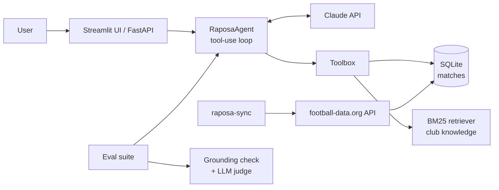

# 🦊 raposa-agent

**An opinionated football agent for Cruzeiro fans, built on the Claude API with tool use, retrieval and evals.**

Ask it about the last match, the next fixture, the head-to-head against Atlético or the 1976 Libertadores. It answers like a fan in the stands of the Mineirão, but every score it mentions has to come from a tool call, and an eval suite checks that.

[](https://github.com/ElderBarbosaLima/raposa-agent/actions/workflows/ci.yml)


## Why this project

Most chatbot demos stop at "LLM + prompt". This one is a small but complete agent system, built the way production LLM features are built:

| Concern | How it's handled |
|---|---|
| **Grounding** | Match facts come only from tools backed by a SQLite store synced from [football-data.org](https://www.football-data.org/). Club history comes from a curated knowledge base via retrieval. |
| **Agent loop** | A hand-written tool-use loop (`src/raposa/agent.py`) with parallel tool calls, tool errors returned to the model, a round limit, refusal handling and server-side fallbacks. |
| **Retrieval** | A dependency-free BM25 retriever over markdown sections, tested for ranking quality on Portuguese and English queries. |
| **Personas** | `fanatic` and `analyst` share the same grounding rules and differ only in voice. Tone is configurable; facts aren't. |
| **Evals** | A deterministic hallucination check (every score in an answer must appear in a tool result), tool-usage assertions, and an LLM judge for behaviour such as honesty about losses and banter without insults. |
| **Engineering** | Typed config, FastAPI service, Streamlit UI, 40+ offline unit tests with a scripted fake client, ruff, and GitHub Actions CI. |

## Architecture



**Tools exposed to the model**

| Tool | What it returns |
|---|---|
| `get_recent_matches` | Last finished matches with score, venue and W/D/L |
| `get_upcoming_matches` | Next fixtures with date (UTC), opponent and venue |
| `get_head_to_head` | Matches and a W/D/L summary against an opponent (accent-insensitive) |
| `get_season_record` | Played, W/D/L, goals, points and recent form for a season |
| `search_club_knowledge` | Top sections from the club history knowledge base |

## Quickstart

Requires Python 3.11+ and [uv](https://docs.astral.sh/uv/).

```bash
git clone https://github.com/ElderBarbosaLima/raposa-agent.git
cd raposa-agent
uv sync
cp .env.example .env   # add ANTHROPIC_API_KEY and FOOTBALL_DATA_API_KEY
```

Sync this season's fixtures (the free football-data.org tier covers the Brasileirão Série A):

```bash
uv run raposa-sync --season 2026
```

Chat in the browser:

```bash
uv run streamlit run app/streamlit_app.py
```

Or run the API and call it:

```bash
uv run uvicorn raposa.api:app --reload
```

```bash
curl -s localhost:8000/chat -H 'content-type: application/json' \
  -d '{"message": "Como foi o último jogo?", "persona": "fanatic"}'
```

## Evals

The eval suite runs the real model against a **synthetic 2099 season** (`tests/fixtures/matches_2099.json`), so every expected answer is known in advance and results are reproducible.

```bash
uv run python -m evals.run
```

Each case in `evals/cases.yaml` can assert:

- **Tool usage**: the right tool was called (e.g. head-to-head questions must hit `get_head_to_head`).
- **Content**: the answer mentions an expected fact.
- **Grounding**: every score in the answer (`2-1`, `2 x 1`, `2×1`) appears in a tool output. This catches invented results without an LLM in the loop.
- **Rubric**: an LLM judge with structured output grades behaviour such as admitting missing data, staying honest about losses, or refusing to insult rival fans.

Results are saved to `evals/results/` so prompt or model changes can be compared run over run.

## Development

```bash
make test   # offline unit tests, no API key needed
make lint   # ruff check + format check
make eval   # live evals (uses the Claude API)
```

## Roadmap

- [ ] Publish eval results for each model/effort setting
- [ ] Scheduled GitHub Action to refresh fixtures after each matchday
- [ ] Cup competitions (Copa do Brasil, Libertadores) via an additional data source
- [ ] Streaming responses in the UI
- [ ] Embedding-based retrieval behind the same `search` interface, compared with BM25 in the evals
- [ ] Public demo deployment

## Data and disclaimer

Match data comes from [football-data.org](https://www.football-data.org/). The club history in `src/raposa/knowledge/docs/` is a hand-curated summary; corrections are welcome via pull request. This is an independent fan project with no affiliation to Cruzeiro Esporte Clube.

## License

MIT
